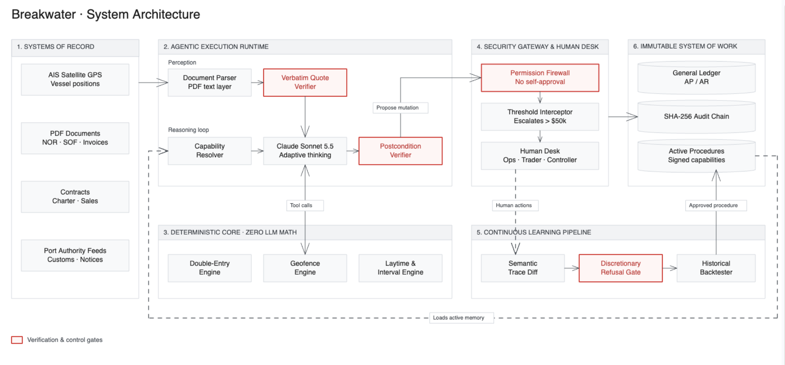

# Breakwater

**A shipping finance desk that investigates delays, handles the resulting claims and accounting, and learns from human corrections.**

When a ship takes longer to load or unload than its contract allows, someone owes extra money. These charges are called **demurrage**. A trading company may owe the shipowner while recovering a different amount from the cargo buyer or seller. The contracts, evidence and deadlines rarely line up neatly.

Breakwater follows both sides of that obligation. It checks documents against vessel telemetry, calculates the amounts, asks the right person when a decision needs authority, and records the financial result. Its learning loop turns useful human interventions into approved procedures and contract rules for later cases.

## Watch the demo

Project explanation and application walkthrough.

[Watch on YouTube](https://youtu.be/MlzrFt0Pl9k)

## What the application does

The **Desk** shows company exposure, open voyages, accounting periods and unanswered questions. Each **Voyage Room** brings together a map, a synchronized evidence timeline, original PDFs, the investigation feed and financial statements. Selecting a human role opens the relevant workspace without losing the case context.

- **Investigates:** compares readiness notices, vessel geo-location, port events and statements of facts.
- **Calculates:** applies each contract's allowed time, rates and exceptions separately.
- **Coordinates:** asks Operations for evidence, the Trader for commercial choices and the Controller for financial approval.
- **Records:** generates claim and dispute documents, posts balanced journals and preserves decision history.
- **Improves:** reuses approved lessons and shows where they affected subsequent work.

## How it learns—and what it refuses to learn

The learning signal is the difference between the agent's investigation and the human actions that actually contributed to an answer.

In the demo, the agent cannot verify a customs hold from its permitted sources. An Operations colleague searches the customs portal, opens the release and links it to the hold. Breakwater proposes a procedure: check that source, verify the vessel and interval, and escalate if valid evidence is missing. The source person confirms its scope; historical cases test the procedure; the Controller approves the new access.

On a later voyage, that approved procedure finds the evidence without another Operations question.

A Controller's correction can similarly become a contract-specific rule. A Trader's goodwill waiver stays a **precedent**: useful context, with no executable instruction to repeat the discount.

**Self-improvement here means a change in approved future behavior, not model retraining or permission to rewrite its own code.**

## Why the system is built this way

The model handles interpretation and investigation. Code owns the calculations and authority. The design gives each a clear boundary:

| Technique | Purpose |
|---|---|
| **Document extraction with verbatim quote checks** | Require extracted facts to point back to text in the source PDF. A matching quote establishes traceability, not the truth of the document. |
| **Telemetry and geofence checks** | Compare a claimed arrival with time-stamped vessel positions and contract-defined port boundaries. |
| **Deterministic time and money engines** | Calculate in integer minutes and cents; normalize local document times to UTC. |
| **Scoped capabilities** | Offer only authorized tools and enforce access again when a tool executes. Approved procedures can grant narrowly scoped read access. |
| **Role-based decision gates** | Enforce delegation limits, materiality and separation of duties before financial actions. The agent never approves itself. |
| **Semantic trace comparison** | Compare contributing searches, opened documents, linked evidence and submitted edits; ignore unrelated browsing. |
| **Typed memory and Jev classification** | Classify lessons by kind, scope and discretion; deterministic gates control whether they can become executable memory. |
| **Historical procedure backtests** | Check whether proposed investigation steps reproduce recorded outcomes, including appropriate escalation. |
| **Task verification and bounded retries** | Check required outputs after a task; repair within limits or leave a visible failure for review. |
| **Idempotent financial writes** | Prevent retries from creating duplicate journals or filings. |
| **Double-entry journals and a SHA-256 audit chain** | Keep postings balanced and make changes traceable through a hash-linked event history. |

Reliability is assessed through these controls and measured outcomes. The **Proof** view reports an actual recorded evaluation against 24 held-out synthetic voyages, including mismatches and unnecessary asks; it shows “Not run yet” when no run exists.

## Architecture

The diagram is conceptual. Capabilities are Controller-approved permission records, not cryptographically signed tokens. The audit chain provides tamper evidence rather than an external guarantee of immutability. Approval thresholds depend on the action; $50,000 is not a universal limit.

**Stack:** Next.js, React and TypeScript for the interface; Convex for state, scheduled work, storage and live updates; Claude for document interpretation and tool use; Jev through `@langchain/typesafe` for lesson classification; MapLibre for maps; Luxon for time-zone conversion.

## Scope and local setup

The prototype uses a fictional company, supplied vessel telemetry, generated PDFs and scripted world events. Investigations, calculations, approval checks, stored memory and journal writes execute against that environment. Claims are generated and recorded locally; no real customs, ERP or bank system is connected, and no cash is moved.

This public source snapshot has not been run or tested. The included test sources and evaluation machinery do not establish its current accuracy. See [progress.md](progress.md) for verification status.

Use Node **22.13+** and this project's own local Convex deployment. Keep Claude and Jev credentials in the Convex environment. The frontend and backend run locally; model calls still require internet access.

- [Local setup, repeatable reset and demo flow](workflow.md)
- [Specification and file map](docs_v2/README.md)
- [Learning and memory contracts](docs_v2/LEARNING.md)
- [Scenario facts and financial answer key](docs_v2/WORLD.md)
